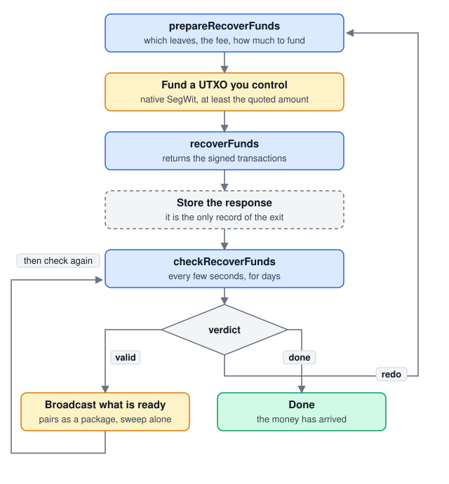

# Unilateral exit

Moves a Spark balance onto Bitcoin without the operators' help. A last resort:
it costs on-chain fees and takes days, because each step waits out a timelock.

This folder is a working implementation. Read it alongside the
[SDK guide](https://sdk-doc-spark.breez.technology/guide/recover_funds.html).
The same calls move funds that already left the balance: that is Recover
Funds, which the wallet list offers as its own row.

## Three calls

| call | you get | when |
|---|---|---|
| `prepareRecoverFunds` | a quote: which leaves, what it costs, how much to fund | once, to decide |
| `recoverFunds` | the signed transactions | once, after funding |
| `checkRecoverFunds` | where it got to, and what to send next | every few seconds, for days |

**Co-signed recoveries.** A leaf the operators moved on-chain comes back as a
cooperative recovery: one transaction they co-sign, paying its fee from the
leaf, so it needs no funding. It goes out when `ready`, and also while
`unverified`, since the network refuses it if its funds already moved. One
still `unverified` six blocks on may never confirm, so this app prepares it
again by name at the same rate, holding its leaf meanwhile, and lets the leaf
go back to the recoverable funds after about a week. One the operators did not
co-sign is listed in `failed`, outside the transactions. `done` covers only the
transactions, so this app keeps such a leaf, and one a rebuild skipped for
now, part of the exit: it prepares it again on the same schedule and builds a
co-signed one into the exit. A unilateral one that needs exit fee of its own
goes back to the recoverable funds once the exit's unilateral steps have
landed.

## The flow

## What you must do

**Pay the fees yourself.** The tree transactions are pre-signed with no fee, so
each is bumped by a child paid from a Bitcoin UTXO you supply. It must be native
SegWit. The quote tells you the amount.

**Store the response.** Both `recoverFunds` and `checkRecoverFunds` return the
recovery; keep the latest. Lose it and you cannot finish, even though the money
is still recoverable. A plan stored under SDK 0.26 does not parse any more, so
`storage/legacyPlan.ts` converts it on load, and it keeps running as it was built.

**Let them keep the exit state off the device.** `exportUnilateralExitState`
returns the leaf data an exit is quoted and built from. It is the one thing the
operators cannot serve again once they stop answering, and it dies with the
device unless the user holds a copy. `importUnilateralExitState` reads it back
into a restored wallet, reporting how many leaves it took and how many it
skipped as another wallet's.

**Broadcast only what is ready.** Each transaction carries a `status`. Send the
ones that say `ready` and leave the rest; a later check will say when their turn
comes. Sending one twice is harmless, so you need not remember what you sent.

**Send the pairs together.** A transaction with a `cpfpTxHex` pays no fee on its
own, so broadcast it and its child as one package through something that
supports package relay. The fan-out and the sweep have no child and go on their
own, anywhere.

**Handle `redo`.** It means the chain no longer matches what you hold, usually
because the operators' watchtower published a refund first. Nothing is lost:
quote and build again, naming the same leaves with a `specific` selection and
passing back the `fundingInputs` you stored. This app does that on its own,
since an exit left alone for days would otherwise stall. A passkey wallet is
the exception: its fee key needs the passkey, which only a tap can ask for, so
its rebuild waits for the tracker's Update & Continue button. A leaf the new
quote skips as `notRecoverable` but lists in `exitChainState.stoppedLeafIds`
waits for the operators to relabel it. This app waits six blocks from when it
first sees the leaf stopped, then lets it go. Recover Funds does the same.

**Let them pay more.** A rebuild reuses the fee rate it was quoted at, so an
exit that has stopped confirming because fees rose needs a new quote at a higher
rate. Offer that at any point, not only when something has gone wrong. A
confirmed fan-out does not cap it: pass the exit's funding back with the new
coins, and the sdk spends them together, fanning out again if it has to. A
co-signed recovery is bumped the same way: quote its leaves again at a higher
rate, to the same address, and the build replaces it on the network. This app
keeps such a build only when it holds every leaf, since a partial one beside
the original would list the same leaf twice.

## Reading this folder

| | |
|---|---|
| `model/plan.ts` | what an exit is: the plan and the one `status` that says where it stands, the leaves it names, its ledger, a pending exit, and plain reads of them |
| `model/progress.ts` | what the tracker shows: what the exit moves, where the money is, how many steps are done, and how many blocks are left |
| `quote.ts` | everything read off a quote, for Recover Funds and the Unilateral Exit alike: what it moves, what it costs, what arrives and whether that is an estimate, whether it needs funding, and what the exit fee address was paid |
| `quoting.ts` | asking `prepareRecoverFunds` for a quote, and which leaves a quote's skips take out of an exit |
| `building.ts` | the one `recoverFunds` build, the plan it makes, and starting a pending exit from its fee coins |
| `pass.ts` | one pass over an exit, step by step: check, rebuild if needed, retry what was left out, send what is ready, then read what landed |
| `check.ts` | reading the exit back with `checkRecoverFunds`, and what the verdict means for the plan |
| `rebuild.ts` | building a diverged or unverified exit again |
| `leftovers.ts` | leaves a build left out, and co-signed recoveries stuck unverified: prepared again, built as the exit's next part, or let go after about a week |
| `recoveries.ts` | kept co-signed recoveries and their fee bumps |
| `exitFee.ts` | what the exit fee address is asked for, what it holds, and what is still to send |
| `feeSweep.ts` | sending what a finished exit left at its fee address to its destination, before the exit is archived |
| `broadcast.ts` | sending each step whose turn has come |
| `ledger.ts` | the record of what landed, and reading what paid each entry out |
| `storage/plan.ts`, `storage/recoveries.ts`, `storage/pending.ts` | the plan, the kept co-signed recoveries and the pending exit, saved per wallet |
| `storage/legacyPlan.ts` | older stored plans converted on load: SDK 0.26's to this SDK's shape, and version 5's phase to the `status` |
| `storage/archive.ts` | finished exits, kept once the plan slot is handed to the next one |
| `storage/accounting.ts` | what the Recoverable Funds row subtracts that no live record holds |
| `engine/api.ts` | starts and stops the engine, hands it a plan, a pending exit or a kept recovery, and starts a pending exit on the user's tap |
| `engine/passes.ts` | a pass over the plan and each kept recovery, what a pass stores or archives, and reading getInfo again once leaves land |
| `engine/polling.ts` | when the passes run: at once on request, then on a timer that slows while nothing can move |
| `engine/state.ts` | the engine state the screens read, and who listens to it |
| `funding.ts` | the key and address the fees are paid from |
| `exitState.ts` | the rolling on-device copy of the leaf data an exit needs |
| `backup.ts` | that copy as a file the user keeps, and reads back |
| `hooks/`, `steps/`, `TrackerView.tsx` | the wizard and the tracker |
